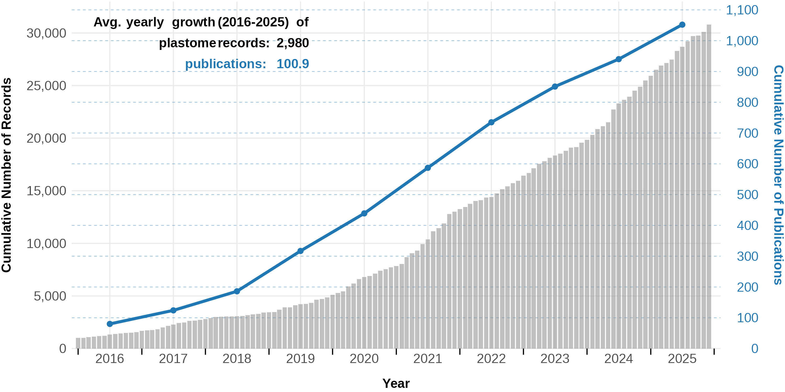
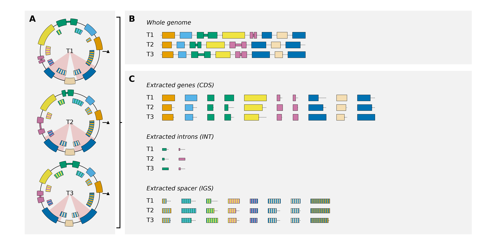
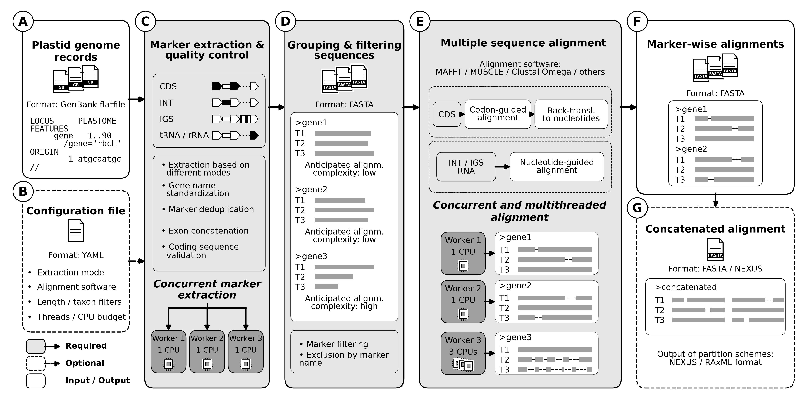
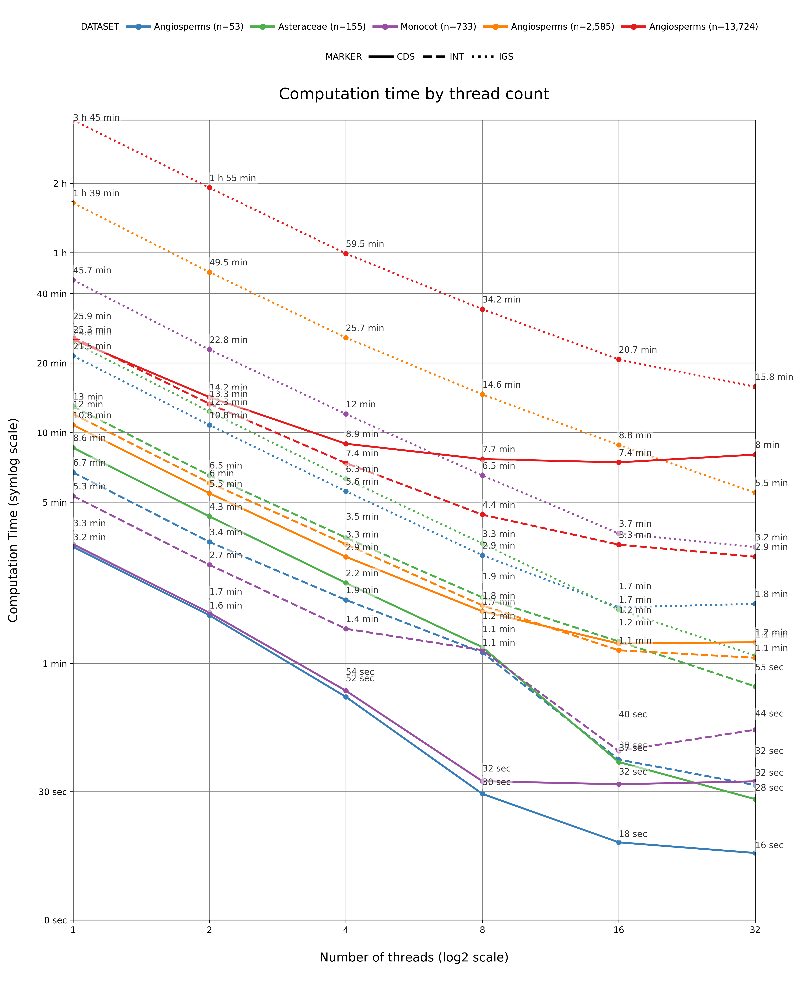
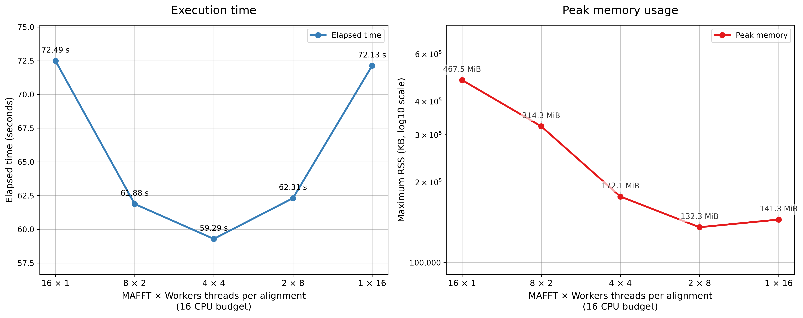
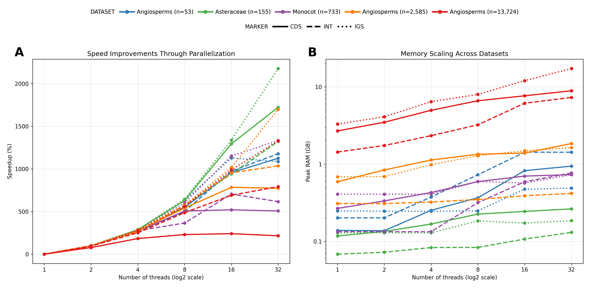
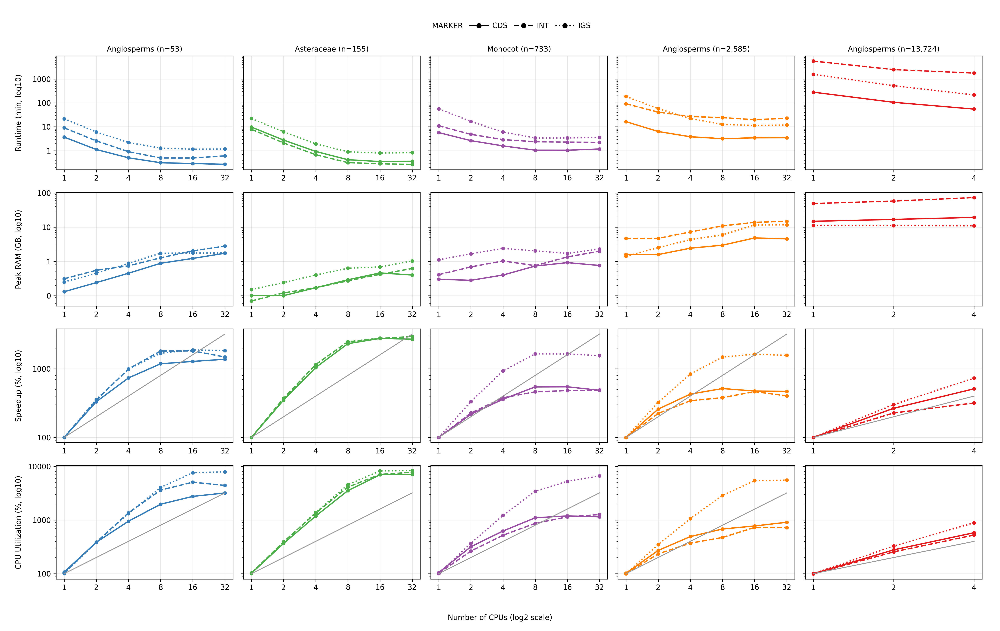

# Paper_Plastburstalign_Figures
Code for generating publication-quality figures and tables for the manuscript.

### Figure 1: Average yearly growth of plastid genome records and plastid genome publications
_Purpose: This figure shall illustrate that plastid genomics remains an active research field with sustained annual publication output and a rapidly expanding body of available genomes. The scale of available genomes now necessitates specialized software (namely ours!) that is capable of efficiently processing and analyzing thousands of plastid genomes simultaneously._

The growth annotations average annual additions over the displayed years; cumulative totals include data from 2000 onward.

```bash
# Dependencies
Rscript -e "install.packages(c('argparse','ggplot2','ggrepel', 'ggtext', 'plyr','dplyr','svglite'), repos='https://cloud.r-project.org')"
# Figure creation
Rscript "CODE_Figure1_AccumulationGraph.R" --input-records "./input_data/output_script1.sorted.unique_2026_06_01.tsv" --input-publications "./input_data/plastome_publications_per_year_2026-10-25.csv" --start-date "2016-01-01" --end-date "2025-12-31" --output "./VIZ_Figure1_AccumulationGraph/Figure1_AccumulationGraph_recordsAndPublications"
```


---

### Figure 2: Schematic overview of what the software does
_Purpose: This figure shall illustrate, for readers with no prior knowledge of the subject, the purpose and functionality of the software using a dataset of three simplistic plastid genomes._

```bash
python CODE_Figure2_MethodOverview.py --output-dir ./VIZ_Figure2_MethodOverview --output-name Figure2_MethodOverview
```


---

### Figure 3: Workflow
_Purpose: This figure shall provide an overview of the plastburstalign workflow, from annotated plastid genomes and optional configuration through sequence extraction and filtering, parallel multiple sequence alignment, and aligned outputs._

```bash
python CODE_Figure3_OverviewWorkflow.py
```


---

### Figure X1: Speed improvements through parallel implementation
_Purpose: This figure shall illustrate the substantial performance gains achieved through multithreading in our software and shall demonstrate that parallel processing is essential when analyzing datasets comprising thousands of genomes. This figure is the only one where all five datasets are compared. Any reader who sees this figure shall immediately recognize that multithreading provides substantial performance gains!_

```bash
python CODE_Figure5_SpeedImprovementsCombined.py ./input_data/benchmarking_results_combined.csv ./VIZ_Figure5_SpeedImprovementsCombined__/PlastomeBurst_ComputationalTimeEprovements_AllMarkers
```


---

### Figure X2: Relative contributions of software and alignment multithreading to performance improvement
_Purpose: This figure shall demonstrate that simultaneous multithreading of both the general software workflow and the alignment software yields greater performance gains than multithreading either component individually._

```bash
python SUPPL-CODE_ParallelismTypesComparison.py ./input_data/benchmark_parallelismTypes_Asteraceae_cds.csv ./SUPPL-VIZ_ParallelismTypeComparison/PlastBurstAlign_Parallelism
```


---

### Figure X3: Optimization of thread allocation for runtime and memory efficiency
_Purpose: This figure shall inform users of the optimal thread settings for achieving the most favorable balance between reduced runtime and efficient RAM utilization._

```bash
python CODE_peakMem_speedup__THANINA-CHANGE.py ./input_data/benchmarking_results_combined.csv ./VIZ_peakMem_speedup__THANINA-CHANGE/peakMem_speedup_across_datasets
```


---

### Supplemental Figure X4: Overview of various optimizations
_Purpose: This figure gives us a detailed look at the various optimizations._

```bash
python CODE_Figure4_CompareFactorsAcrossDatasets.py ./input_data/benchmarking_results_combined.csv ./VIZ_Figure4_CompareFactorsAcrossDatasets/Comparing_factors_grid
```


---

### Table X: Comparison of competitor software
_Purpose: This table may be the only table in the manuscript and shall provide a comparative overview of the capabilities of competing software packages alongside our own software. The comparison criteria should include, among others, the maximum number of input genomes supported, the number of genomes that can be analyzed within a fixed time period (e.g., one hour), the genomic features processed (CDSs, intergenic regions, introns/exons, or combinations thereof), the availability of the source code, the deployment model (server-based or executable on a personal computer), and the user interface type (command-line or graphical). This table should allow readers to quickly assess the functionality, accessibility, scalability, performance, and overall strengths and limitations of each software package._

| Tool                            | Publication               | Version tested | Extracts CDS, INT, and IGS             | Input data limitation                                                    | Runtime duration   | Extraction across multiple genomes | Alignment across multiple genomes | Alignment software choice            | AA-guided alignment                                       | Gene name standardization          | IR/duplicate handling | Source code                                        | Programming language        | Deployment | Interface |
| ------------------------------- | ------------------------- | -------------- | -------------------------------------- | ------------------------------------------------------------------------ | ------------------ | ---------------- | --------------- | ------------------------------------ | --------------------------------------------------------- | ---------------------------------- | --------------------- | -------------------------------------------------- | --------------------------- | ---------- | --------- |
| PhyloSuite                      | Zhang D. *et al.* 2019    | 1.2.3          | Partial[1]                             | **Unclear**                                                              | **Unclear**        | Yes              | Yes             | MAFFT, MACSE                         | Yes                                                       | Yes (lookup-table based)           | Limited               | Open-source                                        | Python 3 (PyQt5)            | Local      | GUI       |
| TBtools-II                      | Chen *et al.* 2023        | 2.376          | No (annotation-dependent; CDS-focused) | **Unclear**                                                              | **Unclear**        | Yes              | Limited         | MUSCLE + external wrappers           | No evidence reported                                      | No dedicated standardization       | No dedicated handling | Source available; but deployed model not open      | Java                        | Local      | GUI       |
| OGU                             | Wu *et al.* 2024          | 1.999          | Yes                                    | Tested on up to 308 plastomes; no explicit hard limit reported           | **Unclear**        | Yes              | Yes             | MAFFT only                           | No                                                        | Yes                                | Yes                   | Open-source                                        | Python 3 (PySide6)          | Local      | CLI + GUI |
| PartitioningExonsIntronsSpacers | de Mestier *et al.* 2025  | 2024.02.14     | Yes                                    | One genome per run                                                       | **Unclear**        | No               | No              | N/A                                  | No                                                        | Extensive hard-coded normalization | Yes                   | Open-source                                        | Python (primarily Python 2) | Local      | CLI       |
| PlastidHub                      | Zhang N.-N. *et al.* 2025 | 1.0            | Yes                                    | Extraction: ≤50 genomes; Alignment: ≤50 sequences and ≤10 kb per dataset | **Unclear**        | Yes              | Yes             | MAFFT (only parameters: -localpair -maxiterate 16) | Translation supported; codon-aware alignment **Unclear** | Yes                   | Yes                   | Open-source                                        | Perl + Spring Boot + Vue    | Web        | Web GUI   |
| PlastBurstAlign                 | This study                | 1.0            | Yes                                    | None reported                                                            | Fast (parallel-enabled) | Yes              | Yes             | Any command-line aligner[2]          | Depends on external aligner                               | Yes                                | Yes                   | Open-source                                        | Python                      | Local      | CLI       |

Notes: [1]: PhyloSuite: CDS extraction is fully supported. Non-coding regions can theoretically be extracted via the NCR functionality, but the extraction limitations and mitochondria-oriented assumptions that may reduce reliability for plastid genomes. [2]: PlastBurstAlign: Configuration files for MAFFT, MUSCLE, and Clustal Omega are provided with the package; however, the software supports integration with any command-line aligner.

### Comparison against similar software
Specifically, we want to compare `PlastBurstAlign` against the functionality of these five competitor software tools:
 
- the tool '*Extract GenBank file*' (EGBF) of PhyloSuite (Zhang D. et al. 2019; [https://doi.org/10.1111/1755-0998.13096](https://doi.org/10.1111/1755-0998.13096)) -- Source code: [https://github.com/dongzhang0725/PhyloSuite](https://github.com/dongzhang0725/PhyloSuite)

- the tools '*Bulk Sequence Extraction*' of TBtools-II (Chen et al. 2023; [https://doi.org/10.1016/j.molp.2023.09.010](https://doi.org/10.1016/j.molp.2023.09.010)) -- Source code: [https://github.com/CJ-Chen/TBtools-II](https://github.com/CJ-Chen/TBtools-II)
  
- the tool '*GB2fasta module*' of OGU (Wu etal. 2024; [https://doi.org/10.1111/1755-0998.14044](https://doi.org/10.1111/1755-0998.14044)) -- Source code: [https://github.com/wpwupingwp/OGU](https://github.com/wpwupingwp/OGU)
  
- the Python script '*PartitioningExonsIntronsSpacers*' by [deMestier et al. 2025](https://doi.org/10.1093/aob/mcaf148) -- Source code: [https://github.com/sannalda/PartitioningExonsIntronsSpacers](https://github.com/sannalda/PartitioningExonsIntronsSpacers)
  
- the tool '*Extraction*' of PlastidHub (Zhang N.-N. et al. 2025; [https://doi.org/10.1016/j.pld.2025.05.005](https://doi.org/10.1016/j.pld.2025.05.005)) -- Source code: [https://github.com/quxiaojian/PlastidHub](https://github.com/quxiaojian/PlastidHub) -- see especially perl script [5.extraction_v1.pl](https://github.com/quxiaojian/PlastidHub/blob/main/scripts/5.extraction_v1.pl)
