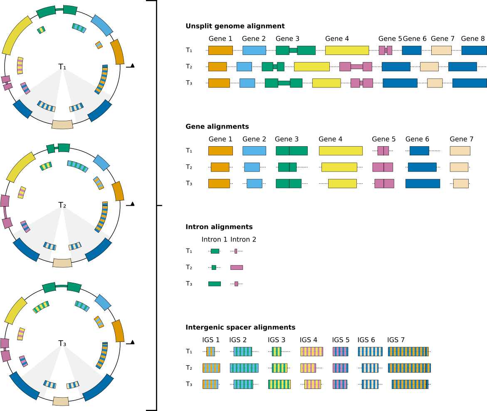
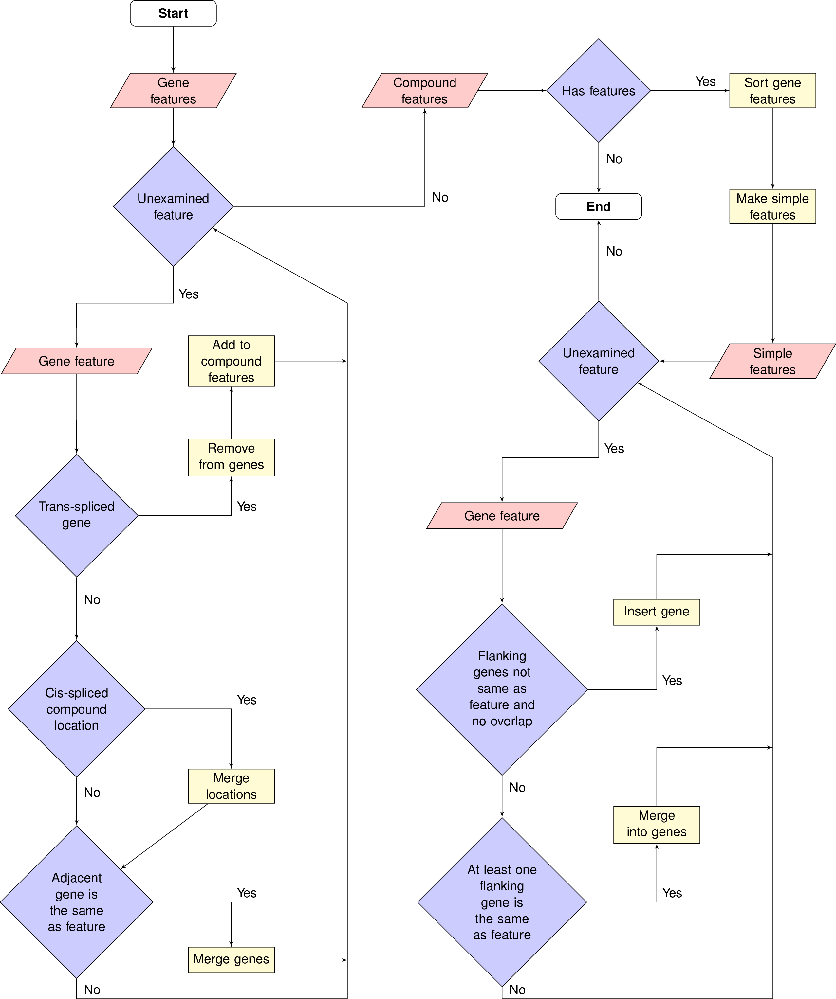
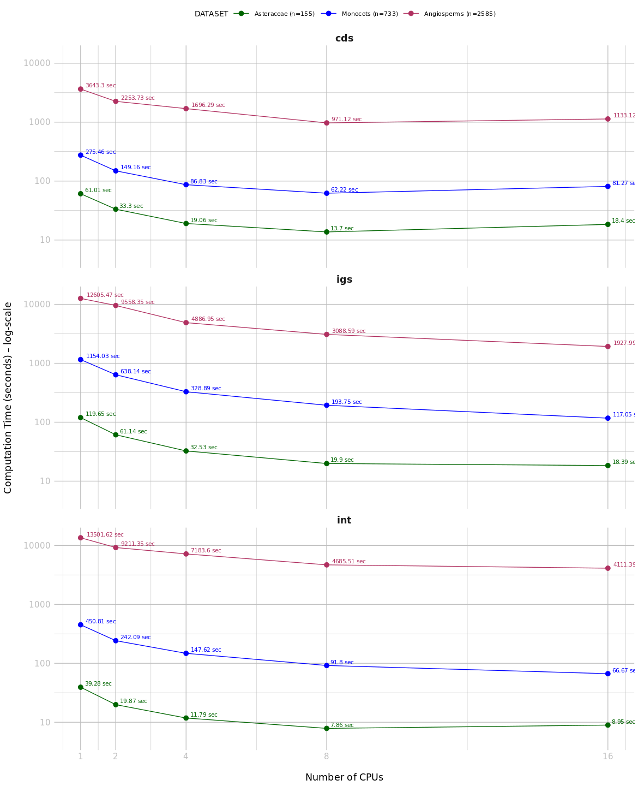

# Paper_Plastburstalign_Figures
Code for generating publication-quality figures and tables for the manuscript.

### Accumulation graphs
```bash
Foo bar baz
```


### Method overview - Schematic
```bash
Foo bar baz
```


### Exon Splicing - Flowchart
```bash
Foo bar baz
```


### Speed Improvements
```bash
Foo bar baz
```

