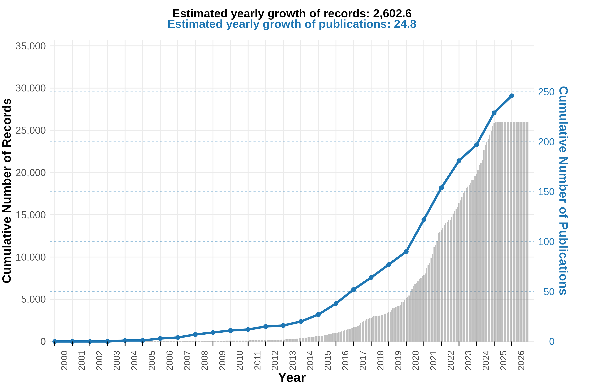
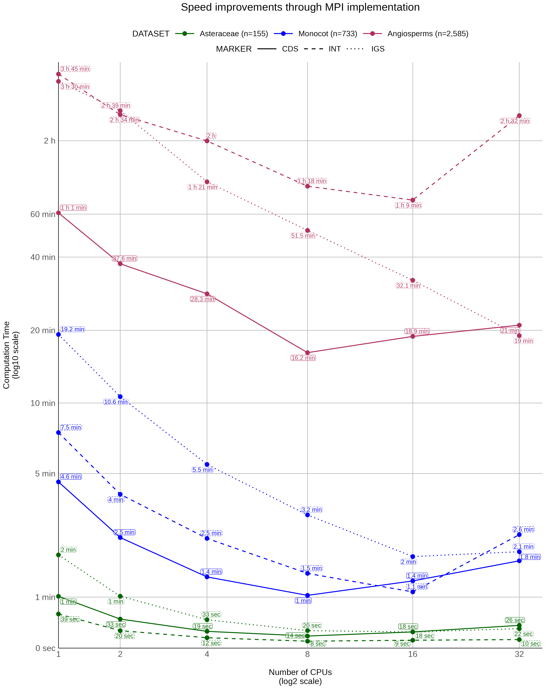

# Paper_Plastburstalign_Figures
Code for generating publication-quality figures and tables for the manuscript.

### Figure 1: Estimated yearly growth of plastid genome records and plastid genome publications
```bash
# Dependencies
Rscript -e "install.packages(c('argparse','ggplot2','ggrepel', 'ggtext', 'plyr','dplyr','svglite'), repos='https://cloud.r-project.org')"
# Figure creation
Rscript "CODE_AccumulationGraph__recordsAndPublications.R" --input-records "./input_data/output_script1.sorted.unique.tsv" --input-publications "./input_data/plastome_publications_per_year_2026-04-27.csv" --start-date "2020-01-01" --end-date "2026-12-31" --output "./VIZ_AccumulationGraphs/AccumulationGraph__recordsAndPublications"
```


---

### Figure 2: Schematic overview of what the software does
```bash
python CODE_MethodOverview.py --output-dir ./VIZ_MethodOverview --output-name VIZ_MethodOverview
```


---

### Table 1: Comparison of competitor software
Foo bar baz

---

### Figure 3: Speed improvements through MPI implementation
```bash
Rscript CODE_SpeedImprovements.R ./input_data/plastburst_benchmark_Final.csv ./VIZ_SpeedImprovements/PlastomeBurst_SpeedImprovements_AllMarkers
```


---

### Figure 4: Relative contributions of software and alignment multithreading to performance improvement
Foo bar baz

---

### Figure 5: Optimization of thread allocation for runtime and memory efficiency
Foo bar baz

---

### Supplemental Figure 1: Flowchart of Exon Splicing
```bash
pdflatex -jobname="./VIZ_FlowchartExonSplicing/VIZ_FlowchartExonSplicing" CODE_FlowchartExonSplicing.tex
rm ./VIZ_FlowchartExonSplicing/VIZ_FlowchartExonSplicing.aux
rm ./VIZ_FlowchartExonSplicing/VIZ_FlowchartExonSplicing.log
convert -density 300 ./VIZ_FlowchartExonSplicing/VIZ_FlowchartExonSplicing.pdf ./VIZ_FlowchartExonSplicing/VIZ_FlowchartExonSplicing.png

## TO DO: Check if the same as the LaTeX version:
python CODE_FlowchartExonSplicing.py --output-dir ./VIZ_FlowchartExonSplicing --output-name VIZ_FlowchartExonSplicing_Python
```

