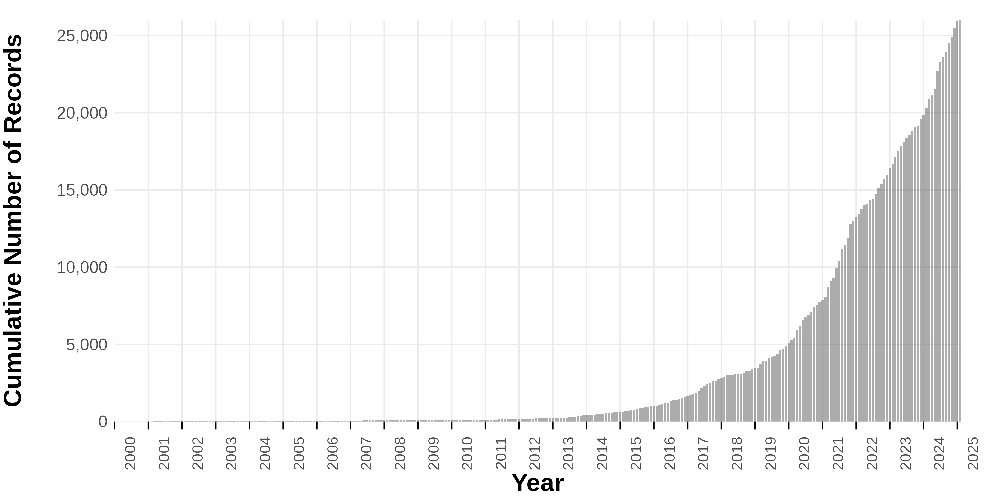
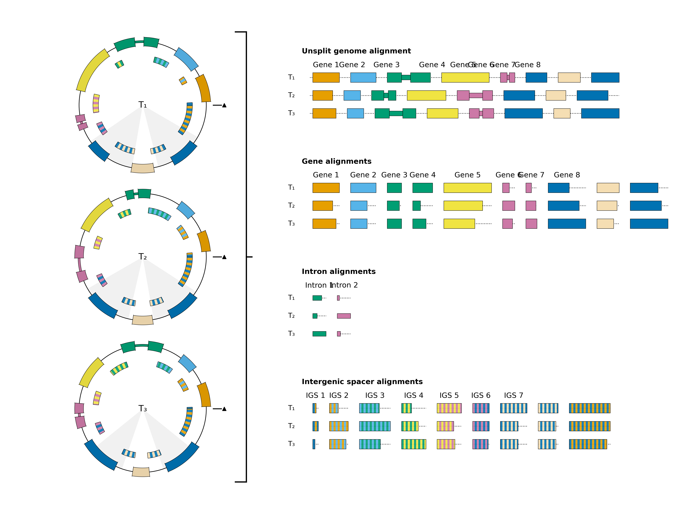

# Paper_Plastburstalign_Figures
Code for generating publication-quality figures and tables for the manuscript.

### Accumulation graphs
```bash
Rscript -e "install.packages(c('argparse','ggplot2','ggtext', 'plyr','dplyr','svglite'), repos='https://cloud.r-project.org')"
```
#### Combined: records (histogram) + publications (blue line)
```bash
Rscript "CODE_a_AccumulationGraph__recordsAndPublications.R" --input-records "./input_data/output_script1.sorted.unique.tsv" --input-publications "./input_data/plastome_publications_per_year_2026-04-27.csv" --start-date "2020-01-01" --end-date "2026-12-31" --output "./VIZ_a_AccumulationGraphs/AccumulationGraph__recordsAndPublications"
```


#### LEGACY: By genome record
```bash
Rscript "CODE_a1_AccumulationGraph__genomeRecords.R" --input "./input_data/output_script1.sorted.unique.tsv" --output "./VIZ_a_AccumulationGraphs/AccumulationGraph__genomeRecords"
```


#### LEGACY: By publications
```bash
Rscript "CODE_a2_AccumulationGraph__publications.R" --input "./input_data/plastome_publications_per_year_2026-04-27.csv" --output "./VIZ_a_AccumulationGraphs/AccumulationGraph__publications"
```


---

### Method overview - Schematic
```bash
python CODE_b_MethodOverview.py --output-dir ./VIZ_b_MethodOverview --output-name VIZ_MethodOverview
```


---

### Exon Splicing - Flowchart
```bash
pdflatex -jobname="./VIZ_c_FlowchartExonSplicing/VIZ_FlowchartExonSplicing" CODE_c_FlowchartExonSplicing.tex
rm ./VIZ_c_FlowchartExonSplicing/VIZ_FlowchartExonSplicing.aux
rm ./VIZ_c_FlowchartExonSplicing/VIZ_FlowchartExonSplicing.log
convert -density 300 ./VIZ_c_FlowchartExonSplicing/VIZ_FlowchartExonSplicing.pdf ./VIZ_c_FlowchartExonSplicing/VIZ_FlowchartExonSplicing.png

## TO DO: Check if the same as the LaTeX version:
python CODE_c_FlowchartExonSplicing.py --output-dir ./VIZ_c_FlowchartExonSplicing --output-name VIZ_FlowchartExonSplicing_Python
```


---

### Speed Improvements
```bash
Foo bar baz
```

