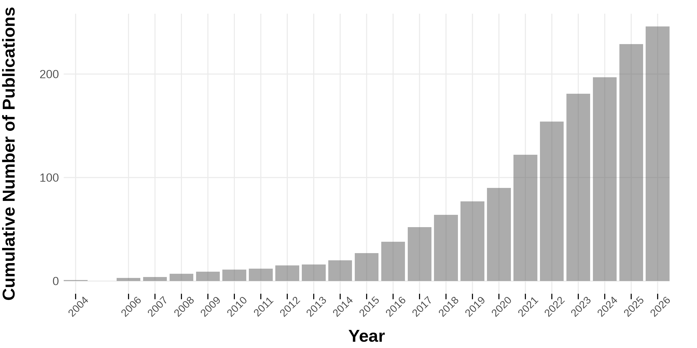

# Paper_Plastburstalign_Figures
Code for generating publication-quality figures and tables for the manuscript.

### Accumulation graphs
```bash
Rscript -e "install.packages(c('argparse','ggplot2','plyr','dplyr','svglite'), repos='https://cloud.r-project.org')"
```

#### By genome record
```bash
Rscript "./CODE_a1_AccumulationGraph__genomeRecords.R" --input "./input_data/output_script1.sorted.unique.tsv" --output "./VIZ_a_AccumulationGraphs/AccumulationGraph__genomeRecords"
```


#### By publications
```bash
Rscript "./CODE_a2_AccumulationGraph__publications.R" --input "./input_data/plastome_publications_per_year_2026-04-27.csv" --output "./VIZ_a_AccumulationGraphs/AccumulationGraph__publications"
```


### Method overview - Schematic
```bash
Foo bar baz
```


### Exon Splicing - Flowchart
```bash
Foo bar baz
```


### Speed Improvements
```bash
Foo bar baz
```

